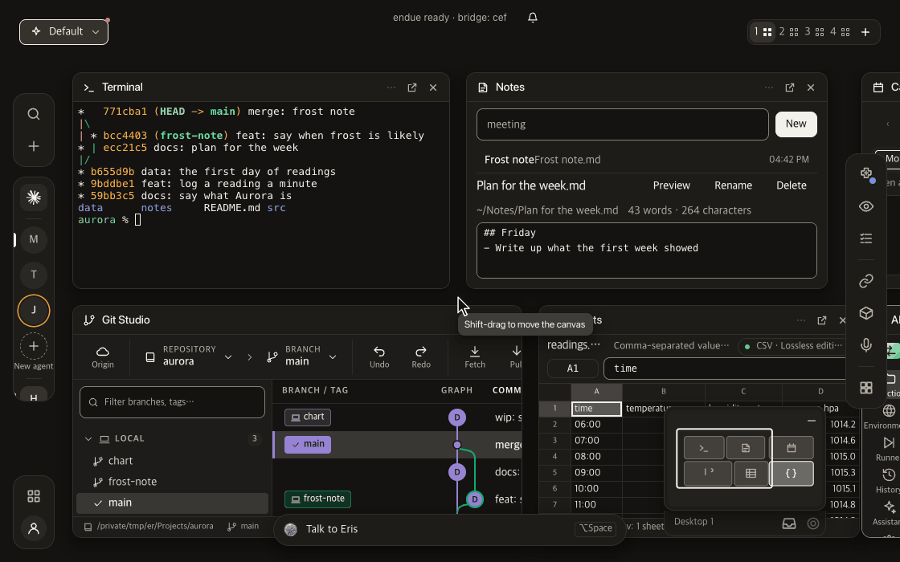

<h1 align="center">
  <a href="https://endue.ai">
    <picture>
      <source media="(prefers-color-scheme: dark)" srcset="brand/endue/endue-original-dark-color-lockup.svg">
      
    </picture>
  </a>
</h1>

<div align="center">

**UI Less is Ultimate UI.**

The open-source desktop where every app lives on one canvas, AI is one sentence away, and no screen is
fixed.

[Website](https://endue.ai) · [Download](#install) · [First five minutes](#your-first-five-minutes) ·
[Make a plugin](docs/plugins/authoring.md) · [Roadmap](docs/roadmap.md)

[](https://github.com/endue-ai/endue/releases/latest)
[](LICENSE)


<sub>English · [日本語](docs/i18n/ja/README.md) · [中文](docs/i18n/zh/README.md) ·
[Français](docs/i18n/fr/README.md) · [Deutsch](docs/i18n/de/README.md) · [한국어](docs/i18n/ko/README.md)</sub>

<a href="#install"></a>

</div>

endue is a desktop app that is one OS: a terminal, a browser, Git, databases, documents and your agents
open as windows on one canvas, and Eris, the secretary who lives there, does what you ask across all of
them. Every screen is a plugin you can restyle, rewrite or remove while the app runs, until only what
you need is left. The code is Apache-2.0, there is no telemetry, and it works without an account.

> [!NOTE]
> endue is young and changes quickly. The macOS app, for Apple silicon, is signed, notarised and updates
> itself from 0.5.0. Windows and Linux desktop packages are not published yet; on Linux there is the
> command-line tool.

## Why UI Less

Most of an app's interface is there because the app does not know what you want. endue takes three
steps toward the interface you would have built yourself, then lets you take the rest away.

### Every app in one place, and AI you can ask directly

Your tools are windows of one desk instead of separate apps, so one request reaches all of them.
`Alt+Space` opens the talk line: type a command's name to run it, or say what you want and Eris does it
with the desk's own commands, using files, Git, databases, the browser and the viewers through the access
you grant. She keeps her memory on this computer, asks before anything irreversible, and what she changes
can be undone. The agent programs already installed here and your endue agents work beside her.


### A canvas you pan, not screens you switch

The desk is one wide canvas. Windows stay where you put them and you move across them: scroll or hold
Shift and drag to pan, and the map in the corner shows where you are. Drag a window to an edge for half
the screen or to a corner for a quarter, spread everything out to pick one, keep separate desktops for
separate work, and pop any window out into an OS window of its own, then dock it back.



### Shape every view and app until the UI disappears

Nothing on screen is fixed. Switch the theme and the design system, rebind keys, or put your own style
and script on any plugin's page, yourself or by telling Eris ("make the notes text bigger"). Views are
data, themes are values with no code, and a built-in feature is a plugin in the same folder format as
yours: replace it, or turn it off. Profiles save a set of plugins, settings and a layout and switch in
one step.


### Already inside

A terminal, a browser, a file explorer and notes; Git Studio, Docker Studio, API Studio, a database client
and Image Studio; viewers for spreadsheets, documents, slides, PDFs, e-books, images, video, archives and
structured data; a calendar, mail, and every chat service in one interface; a client for language models
that run on this computer. Each is a plugin in [`plugins/`](plugins/README.md). To write your own, copy
the smallest one from [`examples/`](examples/README.md) and run `just dev`: saving a file reloads only
that plugin.

## Your first five minutes

1. **Install endue** from the [latest release](https://github.com/endue-ai/endue/releases/latest) and
   open it ([Install](#install) has the details).
2. **Meet Eris.** The first run introduces her and asks for the microphone (**Not now** is fine) and an
   endue ID (**Skip for now** is fine: nothing needs an account).
3. **Open something.** Press `Mod+Alt+L` (`Mod` is `Cmd` on macOS), type `term` and press Enter. Do the
   same for `notes`. `Mod+K` searches plugins, commands, documents and files in one list.
4. **Move around.** Scroll, or hold Shift and drag, to pan the canvas. Drag a window's title to the left
   edge to give it half the screen.
5. **Ask.** Press `Alt+Space`, type `tile` and press Enter, or say what you want in a sentence.
6. **Make it yours.** Type `theme studio` in the talk line, then pick a theme with the arrows and Enter.

Everything you shape lives in `~/.desk`: `init.yaml`, your profiles, `keys.yaml`, your views and
`plugins.lock`, plain files you can read, edit and keep in git. `endue export <folder|file.zip>` carries
them to another computer (`--with-data` adds the desk's own state, never secrets), `endue import` brings
them back without overwriting your `init.yaml`, and `endue doctor` lists every file with whether it reads
as its spec says.

## Install

| Platform | Get it |
| --- | --- |
| macOS, Apple silicon | The `darwin-aarch64` disk image from the [latest release](https://github.com/endue-ai/endue/releases/latest) |
| macOS, Intel | Not published from 0.5.0 on. The [v0.4.0 release](https://github.com/endue-ai/endue/releases/tag/v0.4.0) has the last `darwin-x86_64` disk image; for a newer version, [build from source](#build-from-source) |
| Linux x86_64, command line | `endue-cli_0.4.0_linux-x86_64.tar.gz` from the [v0.4.0 release](https://github.com/endue-ai/endue/releases/tag/v0.4.0) |
| Windows, Linux desktop | Not published yet: [build from source](#build-from-source) |

On macOS, compare the SHA-256 of the disk image with `SHA256SUMS-macos` on the release page, open the
image and copy `endue.app` into Applications. From 0.5.0 the app offers new versions itself.

The official command is `endue`. Try it from a source checkout with `cargo run -p desk-cli -- --help`.
Existing scripts can keep using `desk` throughout the current major release line.

<details>
<summary>Upgrading from Desk, or from 0.4.0 and earlier</summary>

endue is the graphical app formerly called Desk. 0.5.0 changes the app's identifier to
`ai.endue.desktop`, so it does not take over an earlier copy and starts with a new profile. To keep an
earlier profile, quit endue and copy `~/Library/Application Support/ai.endue.desk` to
`~/Library/Application Support/ai.endue.desktop` before the first launch.

The [endue 0.4.0 release](https://github.com/endue-ai/endue/releases/tag/v0.4.0) has macOS disk images for
Apple silicon and Intel, and the [v0.3.0 download](https://github.com/endue-ai/endue/releases/tag/v0.3.0)
provides them for Apple silicon (`aarch64`) and Intel (`x86_64`). Apple did not notarize v0.3.0. If macOS
blocks the verified app's first launch, select **Open Anyway** for endue Desk under System Settings →
Privacy & Security.

- On macOS, quit Desk, mount the new `.dmg` and open `Install endue.command`. The installer updates an
  existing copy in Applications by its bundle ID, even if you renamed it. If you have several copies or
  another app named endue, open Terminal in the mounted image and run
  `"./Install endue.command" --to "/Applications/Studio.app"` with your chosen path. Select your existing
  Desk copy or an available filename.
- On Windows or Linux, use the same package type as your installed copy when that package is listed.
  Windows keeps the existing installation directory. Debian continues to track the package as
  `endue-desk`.
- Reopen the app. Your profiles and `plugins.lock` stay in `~/.desk`. The app also keeps its existing
  settings, grants and credential references. An installer-only Desk release such as v0.3.0 upgrades
  manually with the installer. The v0.3.0 disk images predate the bundled CLI.

</details>

<details>
<summary>The command-line tool on Linux x86_64 servers</summary>

Download `endue-cli_0.4.0_linux-x86_64.tar.gz` and `SHA256SUMS-cli` from the
[v0.4.0 release](https://github.com/endue-ai/endue/releases/tag/v0.4.0) into an empty directory. Run
`sha256sum -c SHA256SUMS-cli`, then `tar -xzf endue-cli_0.4.0_linux-x86_64.tar.gz`. Set `ENDUE_BRAIN_URL`
to your brain v0 service and run `./endue-cli_0.4.0_linux-x86_64/bin/endue run "hello"`.
[Verification for signed CLI releases](docs/releasing.md#verify-a-linux-cli-download)

</details>

## endue and endue.ai

[endue.ai](https://endue.ai) is the agent platform from the same team: agents that work for you in the
cloud. This app is the open-source desktop they come to. Sign in with an endue ID and your endue agents
and spaces appear on the desk beside the local ones.

Signing in is optional. Without an account Eris runs on a model on this computer or on an agent program
you already have, and everything in this repository works. endue AI and endue ID are closed services;
the app reaches them only through the public contract in [`specs/brain`](specs/brain).

**Privacy.** endue has no telemetry. Crash reports, when they arrive, are opt-in and off by default.

## Why endue

Picture a builder's garage: one room where the builder works in the middle, an assistant remembers and
asks, robot arms do the work, and every wall shows the work in the shape the builder wants. endue is that
garage, on your computer: a daily tool that is agent-native, draws your data in any view, and is yours to
reshape. Where it stands and where it goes is in [`docs/roadmap.md`](docs/roadmap.md).

## Build from source

```bash
pnpm install
just check && just test
just dev
```

You need Rust (the version is pinned in `rust-toolchain.toml`), Node 22+, pnpm, `just`, and cmake and
ninja for the app's Chromium (CEF), which its first build downloads; on Linux also the GTK 3, xdo,
AppIndicator and ALSA headers. The runtime tests run in headless Chromium of the app's own version,
which `just test-e2e` fetches once into `~/.cache/desk`. Run them with `just test-e2e`, never with
Playwright directly.

## Learn more

| I want to | Start here |
| --- | --- |
| Write a plugin, a view or a theme | [`docs/plugins/authoring.md`](docs/plugins/authoring.md), [`examples/`](examples/README.md) |
| See what is built in | [`plugins/`](plugins/README.md) |
| Understand how the layers fit | [`docs/architecture.md`](docs/architecture.md) |
| Know why a decision was made | [`docs/adr/`](docs/adr) |
| See where endue is going | [`docs/roadmap.md`](docs/roadmap.md) |
| Send a change | [`CONTRIBUTING.md`](CONTRIBUTING.md), [`AGENTS.md`](AGENTS.md) (the map, for people and AI agents) |
| Report a vulnerability | [`SECURITY.md`](SECURITY.md) |

## License

Code is licensed under [Apache-2.0](LICENSE). The endue and Eris names, logos and illustrations in
`brand/` are not: see [brand/LICENSE](brand/LICENSE) and [TRADEMARK.md](TRADEMARK.md).
