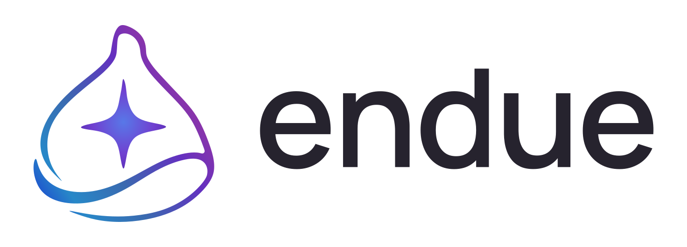
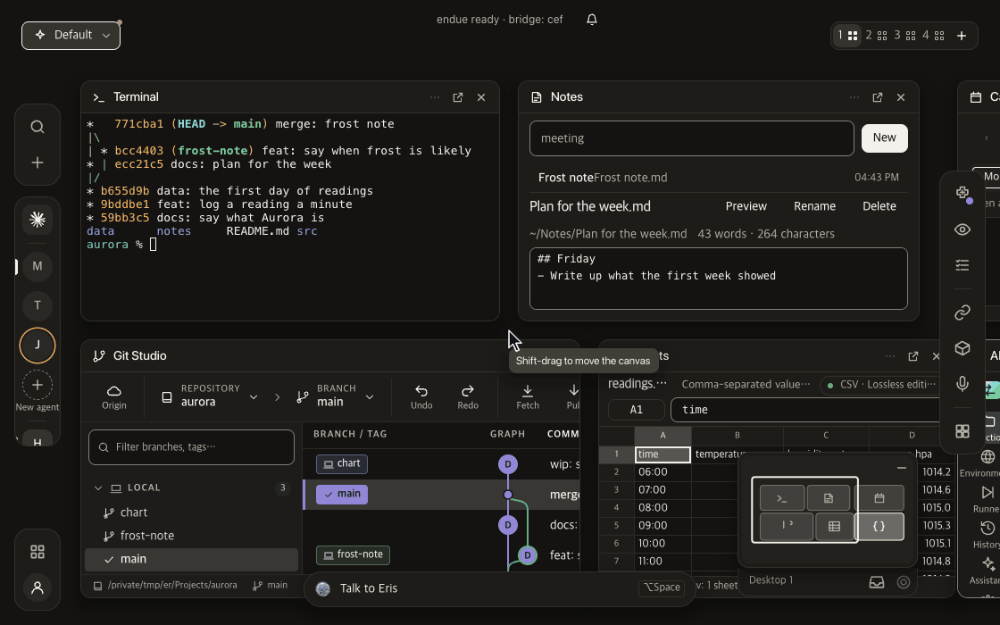
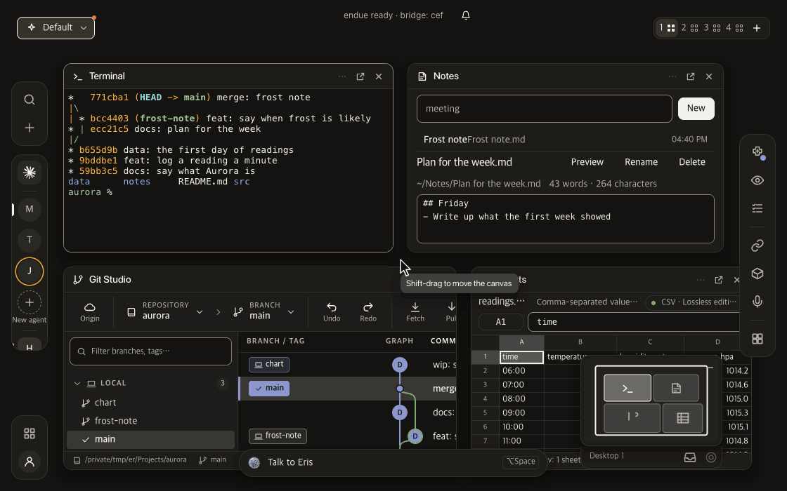

> Dies ist eine Übersetzung. Bei Abweichungen ist die [englische Fassung](../../../README.md) maßgeblich.

<h1 align="center">
  <a href="https://endue.ai">
    <picture>
      <source media="(prefers-color-scheme: dark)" srcset="../../../brand/endue/endue-original-dark-color-lockup.svg">
      
    </picture>
  </a>
</h1>

<div align="center">

**UI Less is Ultimate UI.**

Der Open-Source-Desktop, in dem jede App auf einem einzigen Canvas lebt, die KI nur einen Satz entfernt
ist und kein Bildschirm fest vorgegeben ist.

[Website](https://endue.ai) · [Download](#install) · [Die ersten fünf Minuten](#your-first-five-minutes) ·
[Ein Plugin bauen](plugins/authoring.md) · [Roadmap](../../../docs/roadmap.md)

[](https://github.com/endue-ai/endue/releases/latest)
[](../../../LICENSE)


<a href="#install"></a>

</div>

endue ist eine Desktop-App, die ein OS ist: Ein Terminal, ein Browser, Git, Datenbanken, Dokumente und Ihre
Agenten öffnen sich als Fenster auf einem Canvas, und Eris, die Sekretärin, die dort lebt, erledigt über sie
alle hinweg, worum Sie bitten. Jeder Bildschirm ist ein Plugin, das Sie im laufenden Betrieb neu gestalten,
umschreiben oder entfernen können, bis nur noch übrig ist, was Sie brauchen. Der Code steht unter
Apache-2.0, es gibt keine Telemetrie, und endue funktioniert ohne Konto.

> [!NOTE]
> endue ist jung und ändert sich schnell. Ab 0.5.0 ist die macOS-App signiert und notarisiert und
> aktualisiert sich selbst. Desktop-Pakete für Windows und Linux sind noch nicht veröffentlicht; unter Linux
> gibt es das Kommandozeilenwerkzeug.

## Warum UI Less

Der größte Teil der Benutzeroberfläche einer App ist da, weil die App nicht weiß, was Sie wollen. endue
geht drei Schritte auf die Oberfläche zu, die Sie selbst gebaut hätten, und lässt Sie dann den Rest
wegnehmen.

### Jede App an einem Ort und eine KI, die Sie direkt fragen können

Ihre Werkzeuge sind Fenster eines einzigen Desktops statt getrennter Apps, sodass eine einzige Bitte sie
alle erreicht. `Alt+Space` öffnet das Eingabefeld für Eris: Tippen Sie den Namen eines Befehls, um ihn
auszuführen, oder sagen Sie, was Sie wollen, und Eris erledigt es mit den eigenen Befehlen des Desktops;
dabei nutzt sie Dateien, Git, Datenbanken, den Browser und die Betrachter über den Zugriff, den Sie
gewähren. Ihr Gedächtnis behält sie auf diesem Rechner, sie fragt nach, bevor etwas Unumkehrbares
geschieht, und was sie ändert, lässt sich rückgängig machen. Die hier bereits installierten
Agentenprogramme und Ihre endue-Agenten arbeiten an ihrer Seite.


### Ein Canvas, über den Sie schwenken, keine Bildschirme, zwischen denen Sie wechseln

Der Desktop ist ein einziger breiter Canvas. Fenster bleiben, wo Sie sie hinlegen, und Sie bewegen sich über
sie hinweg: Scrollen Sie, oder halten Sie Shift gedrückt und ziehen Sie, um zu schwenken, und die Karte in
der Ecke zeigt, wo Sie sind. Ziehen Sie ein Fenster an einen Rand für den halben Bildschirm oder in eine
Ecke für ein Viertel, fächern Sie alles auf, um eines auszuwählen, führen Sie getrennte Desktops für
getrennte Arbeit, und holen Sie jedes Fenster in ein eigenes Fenster des Betriebssystems heraus und docken
Sie es danach wieder an.


### Gestalten Sie jede Ansicht und jede App, bis die UI verschwindet

Nichts auf dem Bildschirm ist fest vorgegeben. Wechseln Sie das Theme und das Designsystem, belegen Sie
Tasten neu oder legen Sie Ihren eigenen Stil und Ihr eigenes Skript auf die Seite jedes Plugins, selbst oder
indem Sie es Eris sagen („mach den Text der Notizen größer“). Ansichten sind Daten, Themes sind Werte ohne
Code, und eine eingebaute Funktion ist ein Plugin im selben Ordnerformat wie Ihre eigenen: Ersetzen Sie sie
oder schalten Sie sie ab. Profile speichern eine Zusammenstellung aus Plugins, Einstellungen und einer
Anordnung und lassen sich in einem Schritt wechseln.



### Bereits enthalten

Ein Terminal, ein Browser, ein Dateimanager und Notizen; Git Studio, Docker Studio, API Studio, ein
Datenbank-Client und Image Studio; Betrachter für Tabellenkalkulationen, Dokumente, Folien, PDFs, E-Books,
Bilder, Videos, Archive und strukturierte Daten; ein Kalender, Mail und eine gemeinsame Oberfläche für alle
Chat-Dienste; ein Client für Sprachmodelle, die auf diesem Rechner laufen. Jedes davon ist ein Plugin in
[`plugins/`](../../../plugins/README.md). Um ein eigenes zu schreiben, kopieren Sie das kleinste aus
[`examples/`](../../../examples/README.md) und führen Sie `just dev` aus: Das Speichern einer Datei lädt
nur dieses Plugin neu.

<a id="your-first-five-minutes"></a>

## Ihre ersten fünf Minuten

1. **Installieren Sie endue** aus dem [neuesten Release](https://github.com/endue-ai/endue/releases/latest)
   und öffnen Sie es (die Einzelheiten stehen unter [Installieren](#install)).
2. **Lernen Sie Eris kennen.** Der erste Start stellt sie vor und fragt nach dem Mikrofon (**Not now** ist
   in Ordnung) und nach einer endue ID (**Skip for now** ist in Ordnung: Nichts braucht ein Konto).
3. **Öffnen Sie etwas.** Drücken Sie `Mod+Alt+L` (`Mod` ist unter macOS `Cmd`), tippen Sie `term` und
   drücken Sie Enter. Machen Sie dasselbe mit `notes`. `Mod+K` durchsucht Plugins, Befehle, Dokumente und
   Dateien in einer Liste.
4. **Bewegen Sie sich.** Scrollen Sie, oder halten Sie Shift gedrückt und ziehen Sie, um den Canvas zu
   schwenken. Ziehen Sie den Titel eines Fensters an den linken Rand, um ihm den halben Bildschirm zu geben.
5. **Fragen Sie.** Drücken Sie `Alt+Space`, tippen Sie `tile` und drücken Sie Enter, oder sagen Sie in
   einem Satz, was Sie wollen.
6. **Machen Sie es sich zu eigen.** Tippen Sie `theme studio` in das Eingabefeld für Eris und wählen Sie
   dann mit den Pfeiltasten und Enter ein Theme.

Alles, was Sie gestalten, liegt in `~/.desk`: `init.yaml`, Ihre Profile, `keys.yaml`, Ihre Ansichten und
`plugins.lock`, einfache Dateien zum Lesen, Bearbeiten und Versionieren mit git.
`endue export <folder|file.zip>` nimmt sie auf einen anderen Computer mit (`--with-data` auch den eigenen
Zustand des Desktops, nie Geheimnisse), `endue import` holt sie zurück, ohne Ihre `init.yaml` zu
überschreiben, und `endue doctor` listet jede Datei und ob sie sich so liest, wie ihre Spezifikation es sagt.

<a id="install"></a>

## Installieren

| Plattform | So erhalten Sie es |
| --- | --- |
| macOS, Apple-Chips | Das Disk-Image `darwin-aarch64` aus dem [neuesten Release](https://github.com/endue-ai/endue/releases/latest) |
| macOS, Intel | Das Disk-Image `darwin-x86_64` aus dem [neuesten Release](https://github.com/endue-ai/endue/releases/latest) |
| Linux x86_64, Kommandozeile | `endue-cli_0.4.0_linux-x86_64.tar.gz` aus dem [Release v0.4.0](https://github.com/endue-ai/endue/releases/tag/v0.4.0) |
| Windows, Linux-Desktop | Noch nicht veröffentlicht: [aus dem Quellcode bauen](#build-from-source) |

Vergleichen Sie unter macOS die SHA-256-Prüfsumme des Disk-Images mit `SHA256SUMS-macos` auf der
Release-Seite, öffnen Sie das Image und kopieren Sie `endue.app` in den Ordner „Programme“. Ab 0.5.0 bietet
die App neue Versionen selbst an.

Der offizielle Befehl heißt `endue`. Im Quellverzeichnis können Sie ihn mit
`cargo run -p desk-cli -- --help` ausprobieren. Bestehende Skripte können `desk` in der aktuellen
Hauptversion weiter verwenden.

<details>
<summary>Von Desk oder von 0.4.0 und früher aktualisieren</summary>

endue ist die grafische Anwendung, die früher Desk hieß. 0.5.0 ändert die Kennung der App in
`ai.endue.desktop`; sie übernimmt daher keine frühere Kopie und startet mit einem neuen Profil. Um ein
früheres Profil zu behalten, beenden Sie endue und kopieren Sie vor dem ersten Start
`~/Library/Application Support/ai.endue.desk` nach `~/Library/Application Support/ai.endue.desktop`.

Die [Version endue 0.4.0](https://github.com/endue-ai/endue/releases/tag/v0.4.0) bietet macOS-Disk-Images
für Apple-Chips und Intel, und unter [v0.3.0](https://github.com/endue-ai/endue/releases/tag/v0.3.0) finden
Sie sie für Apple-Chips (`aarch64`) und Intel (`x86_64`). Version v0.3.0 wurde von Apple nicht notarisiert.
Blockiert macOS den ersten Start der geprüften App, wählen Sie in den Systemeinstellungen unter
„Datenschutz & Sicherheit“ für endue Desk „Dennoch öffnen“.

- Beenden Sie Desk unter macOS, öffnen Sie das neue `.dmg` und starten Sie `Install endue.command`. Das
  Installationsprogramm aktualisiert eine vorhandene Kopie im Programme-Ordner, die es an der Bundle-ID
  erkennt, auch wenn Sie sie umbenannt haben. Bei mehreren Kopien oder einer anderen App namens endue
  öffnen Sie ein Terminal im eingebundenen Disk-Image und führen
  `"./Install endue.command" --to "/Applications/Studio.app"` aus. Ersetzen Sie den Beispielpfad durch den
  Pfad zur bestehenden Desk-App oder einen freien Namen.
- Verwenden Sie unter Windows und Linux das bisherige Paketformat, sofern die Version es anbietet. Windows
  behält das Installationsverzeichnis bei. Das Debian-Paket heißt weiterhin `endue-desk`.
- Beim nächsten Start verwendet die App Ihre Profile und `plugins.lock` in `~/.desk` sowie die bisherigen
  Einstellungen, Berechtigungen und Verweise auf Anmeldedaten. Ältere Desk-Versionen wie v0.3.0, die nur als
  Installationspaket ausgeliefert wurden, aktualisieren Sie manuell mit dem neuen Paket. Die Disk-Images von
  v0.3.0 enthalten die CLI noch nicht.

</details>

<details>
<summary>Das Kommandozeilenwerkzeug auf Linux-Servern mit x86_64</summary>

Laden Sie `endue-cli_0.4.0_linux-x86_64.tar.gz` und `SHA256SUMS-cli` von der
[Release-Seite für v0.4.0](https://github.com/endue-ai/endue/releases/tag/v0.4.0) in ein leeres Verzeichnis.
Führen Sie `sha256sum -c SHA256SUMS-cli` und danach `tar -xzf endue-cli_0.4.0_linux-x86_64.tar.gz` aus.
Setzen Sie `ENDUE_BRAIN_URL` auf die Adresse Ihres brain-v0-Dienstes und führen Sie
`./endue-cli_0.4.0_linux-x86_64/bin/endue run "hello"` aus.
[Signierte CLI-Veröffentlichungen prüfen](../../../docs/releasing.md#verify-a-linux-cli-download)

</details>

## endue und endue.ai

[endue.ai](https://endue.ai) ist die Agentenplattform desselben Teams: Agenten, die in der Cloud für Sie
arbeiten. Diese App ist der Open-Source-Desktop, zu dem sie kommen. Melden Sie sich mit einer endue ID an,
und Ihre endue-Agenten und Spaces erscheinen auf dem Desktop neben den lokalen.

Die Anmeldung ist freiwillig. Ohne Konto läuft Eris auf einem Modell auf diesem Rechner oder auf einem
Agentenprogramm, das Sie bereits haben, und alles in diesem Repository funktioniert. endue AI und endue ID
sind geschlossene Dienste; die App erreicht sie nur über den öffentlichen Vertrag in
[`specs/brain`](../../../specs/brain).

**Datenschutz.** endue hat keine Telemetrie. Absturzberichte sind, sobald es sie gibt, Opt-in und
standardmäßig ausgeschaltet.

## Warum endue

Stellen Sie sich die Garage eines Builders vor: ein Raum, in dem der Builder in der Mitte arbeitet, ein
Assistent sich erinnert und nachfragt, Roboterarme die Arbeit tun und jede Wand die Arbeit in der Form
zeigt, die der Builder will. endue ist diese Garage, auf Ihrem Rechner: ein tägliches Werkzeug, das
agenten-nativ ist, Ihre Daten in jeder Ansicht zeichnet und das Sie nach Belieben umgestalten können. Wo
endue steht und wohin es geht, steht in [`docs/roadmap.md`](../../../docs/roadmap.md).

<a id="build-from-source"></a>

## Aus dem Quellcode bauen

```bash
pnpm install
just check && just test
just dev
```

Benötigt werden Rust (die Version ist in `rust-toolchain.toml` festgelegt), Node 22+, pnpm, `just` sowie
cmake und ninja für das Chromium der App (CEF), das ihr erster Build herunterlädt; unter Linux außerdem die
Header von GTK 3, xdo, AppIndicator und ALSA. Die Runtime-Tests laufen in einem Headless-Chromium in der
Version der App, das `just test-e2e` einmalig nach `~/.cache/desk` holt. Die Tests laufen mit
`just test-e2e`, nie direkt über Playwright.

## Mehr erfahren

| Ich möchte | Hier beginnen |
| --- | --- |
| Ein Plugin, eine Ansicht oder ein Theme schreiben | [`docs/plugins/authoring.md`](plugins/authoring.md), [`examples/`](../../../examples/README.md) |
| Sehen, was eingebaut ist | [`plugins/`](../../../plugins/README.md) |
| Verstehen, wie die Schichten zusammenspielen | [`docs/architecture.md`](architecture.md) |
| Wissen, warum eine Entscheidung getroffen wurde | [`docs/adr/`](../../../docs/adr) |
| Sehen, wohin endue geht | [`docs/roadmap.md`](../../../docs/roadmap.md) |
| Eine Änderung einreichen | [`CONTRIBUTING.md`](CONTRIBUTING.md), [`AGENTS.md`](../../../AGENTS.md) (die Übersicht, für Menschen und KI-Agenten) |
| Eine Sicherheitslücke melden | [`SECURITY.md`](SECURITY.md) |

## Lizenz

Der Code steht unter der Lizenz [Apache-2.0](../../../LICENSE). Für die Namen endue und Eris sowie die
Logos und Illustrationen in `brand/` gilt das nicht: siehe [brand/LICENSE](../../../brand/LICENSE) und
[TRADEMARK.md](TRADEMARK.md).
