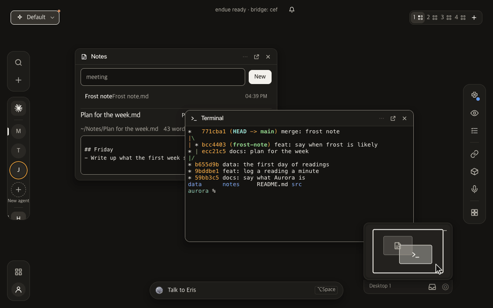

> この文書は[英語版](../../../README.md)の翻訳です。内容に相違がある場合は英語版が優先されます。

<h1 align="center">
  <a href="https://endue.ai">
    <picture>
      <source media="(prefers-color-scheme: dark)" srcset="../../../brand/endue/endue-original-dark-color-lockup.svg">
      
    </picture>
  </a>
</h1>

<div align="center">

**UI Less is Ultimate UI.**

すべてのアプリがひとつのキャンバスに並び、AI には一文で頼め、固定された画面がひとつもない、オープンソースのデスクトップ。

[Web サイト](https://endue.ai) · [ダウンロード](#install) · [最初の 5 分](#your-first-five-minutes) · [プラグインを作る](plugins/authoring.md) · [ロードマップ](../../../docs/roadmap.md)

[](https://github.com/endue-ai/endue/releases/latest)
[](../../../LICENSE)


<a href="#install"></a>

</div>

endue は、ひとつの OS であるデスクトップアプリです。ターミナル、ブラウザー、Git、データベース、ドキュメント、そしてあなたのエージェントが、ひとつのキャンバスの上のウィンドウとして開き、そこに住む秘書の Eris が、そのすべてにまたがってあなたの頼みをこなします。すべての画面はプラグインで、アプリの実行中に見た目を変え、書き換え、取り除けます。必要なものだけが残るまで。コードは Apache-2.0 で、テレメトリはなく、アカウントなしで動きます。

> [!NOTE]
> endue はまだ若く、速く変わっていきます。macOS アプリは 0.5.0 から、署名と公証を受け、自動で更新されます。Windows と Linux のデスクトップ向けパッケージはまだ公開されていません。Linux ではコマンドラインツールを使えます。

## なぜ UI Less か

アプリのインターフェースの大半は、アプリがあなたの望みを知らないからそこにあります。endue は、あなたが自分で作ったはずのインターフェースへ三歩近づき、残りはあなたが取り去れるようにします。

### すべてのアプリがひとつの場所に、そして直接頼める AI

あなたの道具は別々のアプリではなく、ひとつのデスクのウィンドウです。だから、ひとつの頼みがそのすべてに届きます。`Alt+Space` でトークラインが開きます。コマンドの名前を入力すればそれが実行され、やりたいことを言葉で伝えれば、Eris がデスク自身のコマンドでそれを行います。ファイル、Git、データベース、ブラウザー、ビューアーは、あなたが許可したアクセスの範囲で使います。Eris は自分の記憶をこのコンピューターに保ち、取り返しのつかないことの前には確認を取ります。Eris が変えたものは元に戻せます。このコンピューターにすでにインストールされているエージェントプログラムと、あなたの endue エージェントも、Eris と並んで働きます。



### 切り替える画面ではなく、パンするキャンバス

デスクはひとつの広いキャンバスです。ウィンドウは置いた場所にとどまり、あなたがその上を移動します。スクロールするか、Shift を押しながらドラッグするとパンでき、隅のマップが今いる場所を示します。ウィンドウを端へドラッグすれば画面の半分、隅へドラッグすれば 4 分の 1 になります。すべてを広げてひとつを選び、作業ごとに別々のデスクトップを持ち、どのウィンドウも専用の OS ウィンドウとして外に出して、また元に戻せます。


### UI が消えるまで、すべてのビューとアプリを形づくる

画面の上に固定されたものはありません。テーマとデザインシステムを切り替え、キーを割り当て直し、どのプラグインのページにも自分のスタイルとスクリプトを載せられます。自分でやっても、Eris に頼んでも構いません（「ノートの文字を大きくして」）。ビューはデータで、テーマはコードのない値で、組み込みの機能はあなたのプラグインと同じフォルダー形式のプラグインです。置き換えることも、オフにすることもできます。プロファイルはプラグイン、設定、レイアウトの一式を保存し、一度の操作で切り替わります。


### すでに入っているもの

ターミナル、ブラウザー、ファイルエクスプローラー、ノート。Git Studio、Docker Studio、API Studio、データベースクライアント、Image Studio。スプレッドシート、ドキュメント、スライド、PDF、電子書籍、画像、動画、アーカイブ、構造化データのビューアー。カレンダー、メール、そしてひとつのインターフェースにまとめたあらゆるチャットサービス。このコンピューターで動く言語モデルのクライアント。どれも [`plugins/`](../../../plugins/README.md) にあるプラグインです。自分で書くには、[`examples/`](../../../examples/README.md) からいちばん小さい例をコピーして `just dev` を実行します。ファイルを保存すると、そのプラグインだけが読み込み直されます。

<a id="your-first-five-minutes"></a>

## 最初の 5 分

1. **endue をインストールする。** [最新リリース](https://github.com/endue-ai/endue/releases/latest)から入手して開きます（詳しくは[インストール](#install)にあります）。
2. **Eris に会う。** 初回の起動で Eris が紹介され、マイク（**Not now** で構いません）と endue ID（**Skip for now** で構いません。アカウントが必要なものはありません）を求められます。
3. **何かを開く。** `Mod+Alt+L` を押し（`Mod` は macOS では `Cmd`）、`term` と入力して Enter を押します。`notes` でも同じようにします。`Mod+K` は、プラグイン、コマンド、ドキュメント、ファイルをひとつのリストで検索します。
4. **動き回る。** スクロールするか、Shift を押しながらドラッグして、キャンバスをパンします。ウィンドウのタイトルを左端へドラッグすると、そのウィンドウが画面の半分になります。
5. **頼む。** `Alt+Space` を押し、`tile` と入力して Enter を押すか、やりたいことを一文で伝えます。
6. **自分のものにする。** トークラインに `theme studio` と入力し、矢印キーでテーマを選んで Enter を押します。

あなたが形づくるものはすべて `~/.desk` にあります。`init.yaml`、プロファイル、`keys.yaml`、ビューと `plugins.lock` は、読んで編集し git で管理できるただのファイルです。`endue export <folder|file.zip>` で別のコンピューターへ運び（`--with-data` でデスク自身の状態も。秘密情報は含めません）、`endue import` で `init.yaml` を上書きせずに戻し、`endue doctor` で各ファイルが仕様どおり読めるかを一覧できます。

<a id="install"></a>

## インストール

| プラットフォーム | 入手方法 |
| --- | --- |
| macOS、Apple シリコン | [最新リリース](https://github.com/endue-ai/endue/releases/latest)の `darwin-aarch64` ディスクイメージ |
| macOS、Intel | [最新リリース](https://github.com/endue-ai/endue/releases/latest)の `darwin-x86_64` ディスクイメージ |
| Linux x86_64、コマンドライン | [v0.4.0 リリース](https://github.com/endue-ai/endue/releases/tag/v0.4.0)の `endue-cli_0.4.0_linux-x86_64.tar.gz` |
| Windows、Linux デスクトップ | まだ公開されていません：[ソースからビルド](#build-from-source) |

macOS では、ディスクイメージの SHA-256 をリリースページの `SHA256SUMS-macos` と照合し、イメージを開いて `endue.app` を「アプリケーション」にコピーします。0.5.0 からは、アプリが自分で新しいバージョンを案内します。

公式コマンドは `endue` です。ソースからは `cargo run -p desk-cli -- --help` で試せます。現在のメジャーバージョンでは既存のスクリプトで `desk` を引き続き使えます。

<details>
<summary>Desk から、または 0.4.0 以前からのアップグレード</summary>

endue は、これまで Desk と呼ばれていた GUI アプリです。0.5.0 でアプリの識別子が `ai.endue.desktop` に変わるため、以前のコピーを引き継がず、新しいプロファイルで始まります。以前のプロファイルを使い続けるには、最初の起動の前に endue を終了し、`~/Library/Application Support/ai.endue.desk` を `~/Library/Application Support/ai.endue.desktop` にコピーしてください。

[endue 0.4.0 リリース](https://github.com/endue-ai/endue/releases/tag/v0.4.0)には、Apple シリコンと Intel 向けの macOS ディスクイメージがあります。[v0.3.0 の配布ページ](https://github.com/endue-ai/endue/releases/tag/v0.3.0)にも、Apple シリコン用（`aarch64`）と Intel 用（`x86_64`）のイメージがあります。v0.3.0 は Apple の公証を受けていません。照合後も初回の起動がブロックされたら、「システム設定」→「プライバシーとセキュリティ」で endue Desk の「このまま開く」を選んでください。

- macOS では Desk を終了し、新しい `.dmg` を開いて `Install endue.command` を実行します。インストーラーは「アプリケーション」内の既存のアプリをバンドル ID で識別するので、名前を変更していても同じ場所に更新されます。複数のコピーがある場合や endue という名前の別のアプリがある場合は、マウントしたイメージでターミナルを開き、`"./Install endue.command" --to "/Applications/Studio.app"` のパスを既存の Desk または空いている場所に変更して実行します。
- Windows と Linux では、リリースに含まれている場合、以前と同じ形式のパッケージを使います。Windows のインストール先と Debian のパッケージ名 `endue-desk` は引き継がれます。
- アプリを開くと、`~/.desk` のプロファイルと `plugins.lock`、設定、許可、認証情報への参照を引き続き使えます。v0.3.0 などインストーラーのみの Desk からは、新しいインストーラーで手動更新してください。v0.3.0 のディスクイメージには CLI は含まれていません。

</details>

<details>
<summary>Linux x86_64 サーバーでのコマンドラインツール</summary>

[v0.4.0 のリリースページ](https://github.com/endue-ai/endue/releases/tag/v0.4.0)から `endue-cli_0.4.0_linux-x86_64.tar.gz` と `SHA256SUMS-cli` を空のディレクトリにダウンロードします。`sha256sum -c SHA256SUMS-cli` で確認してから、`tar -xzf endue-cli_0.4.0_linux-x86_64.tar.gz` で展開します。`ENDUE_BRAIN_URL` に利用する brain v0 サービスの URL を設定し、`./endue-cli_0.4.0_linux-x86_64/bin/endue run "hello"` を実行します。[署名付き CLI リリースの検証](../../../docs/releasing.md#verify-a-linux-cli-download)

</details>

## endue と endue.ai

[endue.ai](https://endue.ai) は、同じチームによるエージェントプラットフォームです。クラウドであなたのために働くエージェントです。このアプリは、そのエージェントがやって来るオープンソースのデスクトップです。endue ID でサインインすると、あなたの endue エージェントとスペースが、ローカルのものと並んでデスクに現れます。

サインインは任意です。アカウントがなくても、Eris はこのコンピューター上のモデルか、すでにお持ちのエージェントプログラムで動き、このリポジトリにあるものはすべて動作します。endue AI と endue ID はクローズドなサービスで、アプリは [`specs/brain`](../../../specs/brain) にある公開された契約だけを通じてそれらに到達します。

**プライバシー。** endue にテレメトリはありません。クラッシュレポートは、導入された後もオプトイン方式で、デフォルトでは無効です。

## なぜ endue か

ビルダーのガレージを思い浮かべてください。ビルダーが中央で働き、秘書が覚えて尋ね、ロボットアームが手となり、どの壁もビルダーの望む形で作業を映すひとつの部屋。endue はあなたのコンピューターの中にあるそのガレージです。エージェントネイティブで、あなたのデータをどんなビューにも描き、あなたが作り変えられる、毎日使う道具です。endue が今どこにいて、どこへ向かうかは [`docs/roadmap.md`](../../../docs/roadmap.md) にあります。

<a id="build-from-source"></a>

## ソースからビルド

```bash
pnpm install
just check && just test
just dev
```

Rust（バージョンは `rust-toolchain.toml` で固定されています）、Node 22 以上、pnpm、`just`、そしてアプリの Chromium（CEF）のための cmake と ninja が必要です。CEF は最初のビルドでダウンロードされます。Linux ではさらに GTK 3、xdo、AppIndicator、ALSA のヘッダーも必要です。ランタイムのテストはアプリと同じバージョンのヘッドレス Chromium で動き、`just test-e2e` が最初に一度だけ `~/.cache/desk` に取得します。テストは Playwright を直接使わず、`just test-e2e` で実行します。

## 詳しく知る

| やりたいこと | ここから始める |
| --- | --- |
| プラグイン、ビュー、テーマを書く | [`docs/plugins/authoring.md`](plugins/authoring.md)、[`examples/`](../../../examples/README.md) |
| 何が組み込まれているかを見る | [`plugins/`](../../../plugins/README.md) |
| 各レイヤーがどのように組み合わさっているかを理解する | [`docs/architecture.md`](architecture.md) |
| ある決定がなぜなされたかを知る | [`docs/adr/`](../../../docs/adr) |
| endue がどこへ向かうかを見る | [`docs/roadmap.md`](../../../docs/roadmap.md) |
| 変更を送る | [`CONTRIBUTING.md`](CONTRIBUTING.md)、[`AGENTS.md`](../../../AGENTS.md)（人と AI エージェントのための地図） |
| 脆弱性を報告する | [`SECURITY.md`](SECURITY.md) |

## ライセンス

コードは [Apache-2.0](../../../LICENSE) でライセンスされています。`brand/` にある endue と Eris の名称、ロゴ、イラストは対象外です。[brand/LICENSE](../../../brand/LICENSE) と [TRADEMARK.md](TRADEMARK.md) を参照してください。
