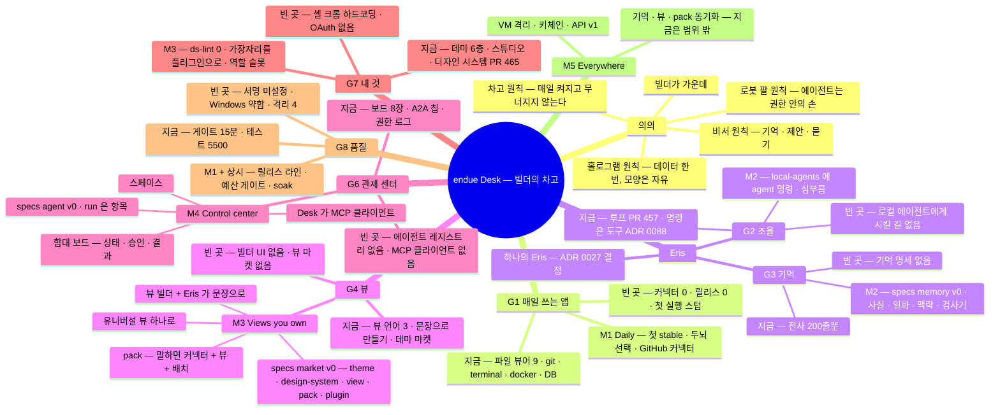

# endue Desk 로드맵

2026-11-05 · Team endue

> Desk 가 *왜* 있고 *어디로* 가는지의 단일 진실입니다. 구조는 `desk-structure.md`, 요구사항은
> `desk-requirements.md`, 되돌리기 어려운 결정은 `docs/adr/`(이 문서의 방향은 ADR 0093)에 있습니다.
> 영어판은 `docs/roadmap.md` 입니다. 마일스톤이 끝나거나 방향이 바뀌면 이 문서를 고칩니다.

## 의의: 빌더의 차고

Desk 는 영화 *Iron Man* 의 차고 연구실에서 영감을 얻었습니다. 그 차고에는 다섯 가지가 있습니다.

| 차고에서 | 뜻 | Desk 에서 |
| --- | --- | --- |
| 호 모양의 키보드. FILE MANAGEMENT · PROGRAMMING 묶음, NEW · OPEN · SAVE · REVERT, SIN · COS · TAN 이 손이 닿는 자리에 있다 | 도구는 한 사람의 손과 일에 맞춰 깎인다. 표준 자판이 아니라 *내* 자판 | 고정된 화면이 없다. 뷰 · 배치 · 키 · 디자인 시스템을 사용자가 정한다 (G4 · G7) |
| 테이블 위 홀로그램. 슈트 · 엔진 · 차가 공중에 떠 있고, 손으로 돌리고 뜯어 본다 | 만드는 것은 눈앞에 있고 만질 수 있다. 데이터가 모양을 갖는다 | 데이터를 한 번 정리하면 어떤 모양으로든 그린다. 뷰가 제품이다 (G4 · G6) |
| 차고의 인공지능 비서. 보이지 않지만 모든 것을 알고, 만든 것을 저장해 둘지 먼저 묻고, 로봇 팔을 부린다 | 비서는 기억하고, 제안하고, 묻고, 조율한다. 주인 대신 결정하지 않는다 | Eris. 자기 기억을 갖고, 로컬 · 외부 에이전트를 조율하고, 되돌리기 어려운 일은 묻는다 (G2 · G3) |
| 로봇 팔들. 용접하고 소화기를 든다. 벽의 모니터에는 설계도 | 에이전트에게는 손이 있지만 결정은 사람이 한다. 결과는 벽에서 한눈에 | 에이전트는 권한 안에서 일하는 호출자. 관제 센터가 모든 에이전트와 결과를 한 화면에 (G6) |
| 차고 자체. 매일 거기서 슈트를 만들고 시험한다. 켜는 순간 공간 전체가 하나의 시스템이 된다 | 여기서 진짜 물건이 만들어진다. 작업장은 매일 켜지고, 무너지지 않는다 | 하나의 앱이 하나의 OS. 빌더가 매일 여는 안정된 작업장 (G1 · G8) |

Iron Man 은 Marvel 의 상표입니다. 영감의 출처로만 언급하며, 이 프로젝트는 Marvel 과 제휴 · 보증 관계가 없고,
영화의 이미지는 이 저장소에 넣지 않습니다.

한 문장으로: **Desk 는 빌더가 매일 여는 차고다. Eris 가 차고를 관장하고, 에이전트가 손이 되고, 모든 것은
빌더가 원하는 모양의 뷰로 보인다.**

Desk 의 역할은 조력자입니다. 안정된 작업 환경을 갖춰 주고, 그 안에서 자유롭게 짜게 두고, 만드는 것의
품질이 변함없이 최고이도록 받칩니다. Desk 는 일하는 방식을 정하지 않습니다. 빌더가 정합니다.

### 다섯 원칙

1. **빌더가 가운데.** 가운데는 사용자의 자리이고 Eris 와 에이전트는 가장자리에 섭니다. 첫 실행의 연출
   원칙(`first-run-scenario.md`)이 곧 제품 원칙입니다.
2. **비서 원칙.** Eris 는 기억하고, 제안하고, 묻습니다. 되돌리기 어려운 일은 승인 뒤에만 합니다
   (ADR 0078). 기억은 기기 안에 있고, 계정은 나중에 그 기억을 다른 기기로 옮기는 수단일 뿐입니다.
3. **홀로그램 원칙.** 데이터는 한 번 정리하고(항목 · 색인, ADR 0032 · 0033) 모양은 얼마든지
   (유니버설 뷰, ADR 0087). 뷰는 코드가 아니라 데이터라서 사람도, Eris 도, 마켓도 같은 것을 만듭니다.
4. **로봇 팔 원칙.** 에이전트는 사람과 같은 커맨드를 자기 이름으로 부르는 호출자입니다 (ADR 0072).
   손은 있되 권한 안에서, 한 화면에서 보이게.
5. **차고 원칙.** 매일 켜집니다. 릴리스 · 업데이트 · 테스트 게이트는 제품의 일부이고, 안정성과 품질은
   기능과 맞바꾸지 않습니다.

## 여덟 목표와 지금

| # | 목표 | 지금 (2026-11-05, `main` 49a1d008) | 가장 큰 빈 곳 | 마일스톤 |
| --- | --- | --- | --- | --- |
| G1 | 빌더가 매일 쓰는 앱 | 파일 뷰어 9 · git · terminal · docker · database · explorer 는 단단함. 릴리스 0, 첫 실행의 로그인 · 폴더 · 커넥터는 스텁 | 하루를 이어 주는 데이터가 없다(커넥터 0). 설치본이 없다 | M1 |
| G2 | 에이전트 네이티브, Eris 가 조율 | 에이전틱 루프가 코어에 들어오는 중(PR #457, ADR 0089). 명령은 도구가 됨(ADR 0088). 로컬 CLI 8종 플러그인(ADR 0084), 외부 앱은 MCP 로 들어옴(ADR 0086) | Eris 가 로컬 에이전트에게 *시킬 길* 이 없다(local-agents 의 `agent` 명령 0). Desk 는 MCP 서버일 뿐 클라이언트가 아님 | M2 · M4 |
| G3 | Eris 의 로컬 기억 | 없음. `brain.json` 전사 200줄, 프레임 50개, 검색 기록 30개가 전부 | 기억 모델 · 저장 · 회수 · 동의가 명세 · ADR · 요구사항 어디에도 없다 | M2 |
| G4 | 사용자가 만들고 마켓에서 받는 뷰 | 뷰 언어 셋(셸 pane · ADR 0032 항목 뷰 · ADR 0087 유니버설 뷰). 문장으로 만들기(`desk.propose`, ADR 0073). 테마 마켓(ADR 0060) | 빌더 UI 없음. 뷰 · 플러그인 마켓 없음(`plugin.install` 없음). propose 는 항목 뷰만 | M3 |
| G5 | 차고의 의의 | 이 문서와 ADR 0093 | — | — |
| G6 | 에이전트 관제 센터 | local-agents 보드(최대 8장), 셸의 A2A 칩, 권한 로그, 승인 카드(ADR 0078) | 에이전트 레지스트리 · 실행(run) 모델 없음. 출처가 셋(두뇌 디렉터리 · 로컬 CLI · MCP)인데 한 화면이 없다 | M4 |
| G7 | 내 디자인 시스템 · UI · 연동 | 테마 6층 + 스튜디오 + 마켓은 단단함. 디자인 시스템이 들어오는 중(PR #465). 모든 플러그인이 토큰 테스트를 가짐 | 셸 크롬(레일 · 바 · 아래 가장자리)은 런타임 하드코딩(ADR 0026 · 0028 제안). 커넥터 OAuth 흐름 없음. 연동 규약(`*.task.move` 등)이 명세가 아님 | M3 · M4 |
| G8 | 안정된 최고 품질의 조력자 | 게이트 15분, 테스트 약 5,500개, 레드-온-베이스 · scope-check · AI 검토. 릴리스 라인 PR #462 | 서명 · 업데이터 비밀 미설정. Windows 미서명 NSIS, MSI 없음(#383). 격리 테스트 4. 호출자 신원이 JS 런타임에서 옴 | M1 + 상시 |

## 전수조사

### 크기

| 항목 | 수 | 비고 |
| --- | --- | --- |
| 나이 | 10일 | 첫 커밋 2026-10-27, 210 커밋, 머지된 PR 214 |
| Rust crate | 14 | 67.9k 줄(생성 포함). `desk-core` 29.7k = 54 %, 테스트 362. `desk-vm` 은 빈 껍데기 |
| TS 패키지 | 5 | runtime 38.9k · ui 8.7k · plugin-sdk 5.6k · bridge 4.3k(+생성 5.1k) · create-plugin 2.4k |
| 플러그인 | 46 | 워크벤치 20 · 시스템 · 정책 12 · 셸 크롬 5 · 뷰 4 · 테마 5 · 에이전트 2(eris · local-agents). 자체 코드 약 139k 줄 |
| 명세 | 10 | bridge(메서드 약 80 · 권한 24) · brain · plugin(kind 8) · item(kind 9) · view · universal · connector · init · update · wit. 전부 v0 |
| ADR | 77장 | 0001–0088, 빈 번호 11, **제안 상태 12**. 주제: 플러그인 21 · 코어 10 · 뷰 10 · 데이터 10 · 에이전트 8 |
| 테스트 | 약 5,500 | vitest 약 4,350 · cargo 약 710 · Playwright 약 270 · scripts 약 170. 격리(quarantine) 4 |
| 릴리스 | 0 | 태그 없음, CHANGELOG 비어 있음. 비밀 미설정이라 모든 게시 워크플로가 멈춤 |
| 열린 것 | 이슈 22 · PR 4 | #457 Eris 루프 · #462 릴리스 라인 · #463 Eris 음성 · #465 디자인 시스템 |

### 층별 상태

- **Rust 코어.** 권한 엔진(기본 거부 · 24 범위 · 에이전트 allowlist · 승인 · 로그), 커맨드 레지스트리와 undo,
  항목 색인(SQLite FTS5), 테마 마켓, 업데이터 파이프라인(검사 · 검증 · 스테이징, 공개키 주입 때만 동작),
  init.yaml 동기화(원격은 `MockRemote`)가 있습니다. 두뇌는 `HttpBrain` 하나이고 기본값이 `brain-echo`
  입니다. **로컬 두뇌(Ollama)는 완성됐지만 어디에도 연결되지 않았습니다.** 오디오 캡처는 `unsupported`,
  소켓은 Unix 전용, 비밀은 0600 파일이고 읽는 곳이 없습니다.
- **웹 런타임.** 컴포지터 · 창 · pane · 프로필 · 데스크톱 1–4 · 테마 엔진 · 테마 스튜디오 · 문장으로 만들기 ·
  Eris 의 몸(메쉬 · 소울 텍스트 · 소리 고리)이 있습니다. 셸 크롬(레일 · 에이전트 바 · 아래 가장자리)은
  런타임 코드이고 dock · sidebar · toolbar 플러그인은 "나중에" 가 적힌 얇은 껍데기입니다. 레이아웃의
  기본 저장소는 메모리이고 실제 저장은 `desk.session` 이 합니다. 샘플 뷰(캘린더 · 노트 · 내일)는 하드코딩입니다.
- **플러그인.** 파일 플러그인(docs · sheets · slides · reader · images · player · data · archives · web)과
  formats 라이브러리, git · terminal · docker · database · explorer · calendar 는 단단합니다. chat · mail ·
  projects · today · chat-digest 는 색인 클라이언트로 잘 만들어졌지만 **먹일 커넥터가 하나도 없습니다**
  (내장은 OS 캘린더 · 미리알림뿐). git 9 · terminal 7 · calendar · database · docker 는 에이전트 도구를
  내지만 local-agents 는 0 입니다.
- **명세와 결정.** `specs/agent` · `specs/market` · `specs/sync` · `specs/memory` 는 없습니다. 셸의 자리
  (0026) · 하나의 Eris(0027) · 가장자리(0028) · 에이전트는 호출자(0072) · 승인(0078) · 제안(0073) 이
  제안 상태입니다. `desk-structure.md` 의 결정 표는 0036 에서 멈춰 있고, 화면 기술을 React 로 적어
  ADR 0010 과 어긋납니다. 열린 PR 두 개가 **ADR 0090 을 동시에 씁니다**(#462 · #465).
- **CI 와 릴리스.** PR 마다 Linux 에서 check · 단위 · 계약 · red-on-base · 런타임 Playwright(재시도 2) ·
  codegen-check · scope-check · 보안 · AI 검토가 돕니다. macOS · Windows 는 릴리스 브랜치에서만. 앱 e2e 는
  Linux 만, 성능 예산은 야간만, 기준값은 darwin-arm64 한 대. 서명 · 공증 · 업데이터 키 · R2 토큰은
  아직 없습니다.

### 진행 중인 것의 자리

| 열린 것 | 무엇 | 이 로드맵에서 |
| --- | --- | --- |
| PR #457 (#456) | Eris 의 에이전틱 루프를 데스크가 돌림, 심부름 연출, endue ID 기기 승인 로그인, ADR 0089 | M1 의 전제. M2 가 그 위에 기억과 위임을 얹음 |
| PR #463 (#461) | Eris 클릭으로 듣기 · 생각 · 말하기, 불투명한 몸 | M1 |
| PR #465 (#464) | 디자인 시스템이 주 기능: 컴포넌트 레시피 · 스튜디오 · 마켓 · ds-lint. ADR 0090 · 0091 | M1 머지, M3 에서 ds-lint 0 과 셸 크롬 이전 |
| PR #462 (#460) | 릴리스 라인 · beta 후보 · 단계 stable. ADR 0090 | M1 의 첫 릴리스가 이 파이프라인으로 나감. 번호 충돌을 머지 때 정리 |
| #321 · #322 · #351 | 업데이트 적용 · 패닉 훅 · 앱이 코어에 파일을 안 넘기는 버그 | M1 |
| #272 · #273 · #383 | UI 프레임 감시와 브리지 속도 제한 · 야간 soak · chaos · Windows MSI | 상시 품질 트랙 |
| #287 · #288 · #290 | plugins.lock · export · import · 설정 lint | M3(마켓과 pack 의 전제) |
| #279 · #430 · #404 · #410 | undo 키 · 포커스 · mail · Eris 타임라인 | M1 잔손질 |

## 로드맵

마일스톤은 *빌더에게 무엇이 되는가* 로 끝을 정합니다. 날짜는 지난 열흘의 속도(PR 214, 레인 병렬)로
잡은 **추정 창** 이고, M2 · M3 · M4 는 레인이 겹치지 않아 병렬로 돌되 끝나는 순서가 이 순서입니다.

| 마일스톤 | 이름 | 끝나면 되는 것 | 목표 창 |
| --- | --- | --- | --- |
| M1 | Daily | 팀이 매일 Desk 를 열고, 첫 stable 설치본이 업데이터로 들어오고, 오프라인에서도 Eris 가 로컬 두뇌로 답한다 | 2026-11 |
| M2 | Eris remembers | Eris 가 자기 기억을 갖고, 재시작 뒤에도 이어 가며, 로컬 에이전트에게 일을 시키고 결과를 가져온다 | 2026-12 |
| M3 | Views you own | 어떤 출처든 문장 하나로 원하는 모양의 뷰가 되고, 뷰 · pack · 디자인 시스템을 마켓에서 받고, 셸의 모든 가장자리가 플러그인이다 | 2027-01 |
| M4 | Control center | 모든 에이전트(로컬 CLI · endue · MCP · Eris)가 한 레지스트리에 있고, 한 화면에서 상태 · 승인 · 결과를 본다 | 2027-02 |
| M5 | Everywhere | 로그인하면 기억 · 뷰 · pack 이 다른 컴퓨터로 따라온다. MCP 도구는 VM 안에서 돈다 | 2027-Q2 |

### M1 Daily: 매일 여는 데스크

G1 · G8. 차고는 매일 켜져야 차고입니다. 기능보다 먼저 *설치되고 · 켜지고 · 답하는* 데스크를 만듭니다.

할 일

1. 열린 PR 넷을 머지합니다 (#457 → #463 → #462 → #465). ADR 번호를 0089 · 0090 · 0091 · 0092 로 정리합니다.
2. 첫 stable 0.1.0 을 릴리스 라인으로 냅니다. 서명 · 공증 · 업데이터 키 · R2 를 `docs/releasing.md` 대로
   설정하고, "Restart to update" 가 실제로 올립니다 (#321). 패닉 훅과 `desk doctor` (#322), 앱이 grant ·
   설정 · 로그 폴더를 코어에 넘기는 버그 (#351).
3. 두뇌를 고릅니다. 설정에서 endue AI · 로컬(Ollama) · echo 를 바꾸고(`shell-bridge` 의 "not served yet"
   제거), 오프라인이면 로컬 두뇌로 내려갑니다. `desk-brain-local` 을 앱에 연결합니다.
4. 하루를 이어 주는 첫 데이터. 빌더의 하루는 git · 이슈 · 캘린더 · 노트입니다. GitHub Issues · PR 을
   `task` 항목으로 읽는 첫 실제 커넥터(코어 `http` 바인딩, 비밀은 읽기만), Today 가 tasks · notes 에 묶입니다.
5. 첫 실행의 스텁 셋(endue ID · 폴더 고르기 · 커넥터)을 진짜로 바꿉니다. 미국 전용 안내는 설정으로 뺍니다.
6. 품질 바닥. Windows 소켓(named pipe), 호출자 신원을 런타임이 아니라 프레임 출처에서 정하기, 브리지
   속도 제한과 프레임 감시(#272), 격리 테스트 4 → 0.

끝나면 되는 것과 측정

- 팀원 전원이 평일마다 Desk 를 연다 (dogfooding 일수 · 떠 있는 시간).
- stable 0.1.x 가 3 OS 에 설치되고 업데이트가 들어온다. 시작 시간 · 유휴 메모리 예산이 PR 게이트에 들어간다.
- 네트워크를 끊어도 Eris 가 답한다.

### M2 Eris remembers: 기억하고 심부름시키는 비서

G3 · G2. 차고의 비서는 기억합니다. 지금 Eris 는 세션이 끝나면 아무것도 모릅니다.

할 일

1. **`specs/memory/v0`.** 기억은 세 겹입니다. *사실과 선호*(사람이 읽는 YAML, "당신은 PR 을 아침에
   본다"), *일화*(대화 · 심부름 · 결과의 전사, 세션을 넘어 이어짐), *작업 맥락*(지금 열린 것 · 최근 커맨드 ·
   보고 있는 항목, 자동). 전부 데이터 폴더 아래 파일 집합이라 M5 의 동기화가 파일 동기화(ADR 0016 모형)로
   끝납니다. 회수는 `desk-index` 의 FTS5 로 시작하고, 임베딩은 로컬 두뇌가 있을 때만 더합니다.
2. **`memory.*` 브리지와 권한.** `memory:read` · `memory:write` 범위. Eris 만 기본으로 쓰고, 다른
   에이전트는 grant 로. 사람이 보는 **기억 검사기**: 무엇을 아는지, 잊히기, 고치기. 사실을 저장하기 전에
   "기억해 둘까요?" 하고 묻는 정책(ADR 0078 의 승인과 같은 틀).
3. **턴마다 맥락 조립.** 코어가 `brain.turn` 앞에 기억 · 작업 맥락 · 열린 항목을 모읍니다. 로컬 두뇌와
   endue AI 가 같은 모양을 받습니다(`specs/brain` 의 세션 메타).
4. **하나의 Eris.** ADR 0027 을 결정으로 올려 `plugins/eris` 와 셸의 Eris 를 합칩니다. 심부름(PR #457)이
   플러그인 쪽으로 옵니다.
5. **로컬 에이전트에게 시키기.** local-agents 의 명령에 `agent` 를 달아 Eris 가 `desk-run` 으로 Claude ·
   Codex 에게 일을 넘기고, 결과가 심부름으로 돌아오고, 일화 기억에 남습니다. 승인 카드(ADR 0078 → 결정)
   가 되돌리기 어려운 호출을 막습니다.
6. 에이전트 안전 ADR 셋(0072 · 0073 · 0078)을 제안에서 결정으로 올립니다.

끝나면 되는 것과 측정

- 앱을 껐다 켜도 Eris 가 어제 일과 내 선호를 안다. 기억 검사기에서 한 줄을 지우면 정말 잊는다.
- "이 레포 테스트 돌려 봐" 가 Claude Code 로 가서 결과가 Eris 의 말로 돌아온다. 되돌리기 어려운 일은
  카드가 먼저 뜬다.
- 로컬 두뇌만으로도 같은 흐름이 돈다.

### M3 Views you own: 뷰는 당신 것

G4 · G7. Desk 의 핵심 가치입니다. 데이터만 정리되면 모양은 사용자가, 또는 사용자를 대신해 LLM 이 만듭니다.

할 일

1. **뷰 언어 하나.** 유니버설 뷰(ADR 0087)를 *그* 뷰로 삼습니다. 항목 뷰(ADR 0032)의 `requires` 는
   유니버설 뷰의 `items` 출처로 흡수하고, 빠진 컴포넌트(차트 · 상세 · 통계)를 유니버설 쪽에 더합니다.
   셸 pane 의 샘플 뷰는 유니버설 뷰 파일로 바꿉니다. 하나의 ADR 로 전환 규칙을 적습니다.
2. **뷰 빌더.** 출처 고르기(파일 · URL · 커맨드 · 항목) → 모양 고르기(타임라인 · 캘린더 · 보드 · 목록 ·
   글 · 대화 · 에이전트 · 차트) → 필드 매핑 → 저장. 같은 일을 Eris 가 문장 하나로 합니다(`desk.propose`
   의 대상을 유니버설 뷰로, 미리보기 · 적용 · 되돌리기는 ADR 0073 그대로). 뷰는 YAML 이라 둘이 같은
   파일을 만듭니다.
3. **`specs/market/v0`.** 테마 마켓의 `desk-theme-index/1` 을 kind 로 넓힙니다: theme · design-system ·
   view · pack · plugin. `plugin.install` 브리지 메서드, sha256 과 서명(ADR 0005), `plugins.lock`(#287),
   권한 차이 표시. 인덱스는 지금처럼 이 레포의 정적 파일이고 PR 이 심사입니다.
4. **pack.** "지라" 라고 말하면 커넥터 + 뷰 + 배치가 한 묶음으로 생기는 데이터 전용 kind. 커넥터의 코어
   `http` 바인딩과 OAuth 흐름이 여기서 명세가 됩니다. 연동 규약(`*.task.move` · `*.chat.send` ·
   `*.mail.send`)을 `specs/connector` 에 올립니다.
5. **디자인 시스템 끝까지.** ds-lint 286 → 0, 셸 크롬(레일 · 바 · 아래 가장자리)을 플러그인으로 옮겨
   (ADR 0026 · 0028 → 결정) 가장자리마다 갈아끼울 수 있게, `provides` 역할 슬롯(BR-05)으로 팔레트 · 설정 UI
   제공자를 고릅니다. export · import(#288)로 내 데스크가 파일로 오갑니다.

끝나면 되는 것과 측정

- 개발자가 아닌 사람이 URL 하나를 1분 안에 원하는 모양의 뷰로 만들고, 모양을 바꿔도 데이터는 그대로다.
- 마켓에서 뷰 · pack · 디자인 시스템을 받고, 권한이 늘면 설치 전에 보인다.
- 디자인 시스템을 바꾸면 컨트롤 100 % 가 따라온다(ds-lint 0).

### M4 Control center: 관제 센터

G6 · G2. 에이전트가 많아질수록 한 화면이 필요합니다. 관제 센터는 새 앱이 아니라 *에이전트 실행 위의 뷰* 입니다.

할 일

1. **`specs/agent/v0`.** 출처가 무엇이든(로컬 CLI · endue AI 디렉터리 · MCP 클라이언트 · Eris) 같은
   레코드: id · 이름 · 색 · 두뇌 · 도구 · 권한 · 상태. 실행(run)은 항목의 `kind: run` 으로 색인에
   들어가 모든 뷰가 그립니다(일화 기억과 같은 모형).
2. **`agent.runs.*`** 브리지: 시작 · 취소 · 승인 대기 · 결과. 백그라운드 큐(AG-07)와 오프라인 적재.
3. **관제 센터 뷰.** 유니버설 `agent` 모양 위에 함대 보드: 누가 돌고, 누가 승인을 기다리고, 무엇이 끝났고,
   결과는 무엇인지. 비용 · 시간. 한 번에 보는 승인 받은편지함. 이 화면도 뷰 파일이라 바꿀 수 있습니다.
4. **Desk 가 MCP 클라이언트.** 외부 MCP 서버를 도구로 붙입니다. 먼저 프로세스 안에서 권한으로 묶고,
   VM 격리(ADR 0002)는 M5 에서.
5. **스페이스(AG-06).** 에이전트 둘 이상 + 공유 표면 + 공유 저장소. 첫 실행 "함께 일할 공간" 장면이
   진짜가 됩니다.

끝나면 되는 것과 측정

- Claude Code · endue 의 에이전트 · MCP 로 들어온 앱이 한 보드에 같이 보이고, 각각을 멈추고 승인한다.
- Eris 가 한 일을 셋에게 나눠 주고 결과를 한 뷰로 모은다.

### M5 Everywhere: 어디서나 같은 데스크

G3 의 동기화와 G8 의 깊이. 지금은 범위 밖이지만 M2 의 파일 배치가 이 단계를 전제로 합니다.

- `specs/sync/v0` · `specs/account/v0`: 기억 · 뷰 · pack · 설정이 endue ID 를 따라옵니다. 파일 단위 3-way,
  충돌은 덮어쓰지 않습니다(ADR 0016). grant · 비밀 · 로그는 기기에 남습니다(SY-03).
- `desk-vm` 으로 MCP 도구 격리, OS 키체인, Windows 서명과 MSI, 3D 컴포지터, 플러그인 API v1 동결(ADR 0004).

### 상시 트랙

- **품질.** 릴리스 라인의 canary → beta → stable 이 매주 돕니다. 성능 예산을 3 OS 에서 PR 게이트로.
  야간 soak · chaos · 브리지 퍼즈(#273). 격리 테스트는 0 을 유지합니다.
- **문서.** `desk-structure.md` 의 결정 표를 최신 ADR 까지, `desk-requirements.md` 의 *현재* 열을 마일스톤
  마다. ADR 번호는 PR 을 열 때 이 문서의 *진행 중* 표에서 예약합니다.
- **도그푸딩.** 팀이 Desk 로 Desk 를 만듭니다. 매주 "오늘 Desk 가 막은 것" 한 줄이 이슈가 됩니다.

### 하지 않는 것

`desk-requirements.md` 의 목록 그대로입니다. IDE 가 아니고, 자체 스크립트 언어가 없고, 브라우저 엔진을
내장하지 않고, 텔레메트리가 없고, 두뇌 말고는 클라우드 없이 안 되는 기능이 없습니다. 여기에 둘을 더합니다.
기억의 동기화는 M5 전에는 하지 않고, 에이전트가 사람의 승인 없이 되돌리기 어려운 일을 하는 모드는 만들지 않습니다.

## 킬링 피처 레인

사용자가 느끼는 순간 기준으로 줄을 세운 열둘이고, 레인 넷이 동시에 돌고 레인 안에서는 순서대로 갑니다(ADR 0015).
열린 PR #457 · #462 는 각 레인의 첫 일로 마무리합니다.

| 순위 | 사용자가 느끼는 순간 | 이슈 | 레인 |
| --- | --- | --- | --- |
| 1 | 문장 하나로 어떤 출처든 원하는 모양의 뷰가 된다 | #472 · #474 | views |
| 2 | Eris 에게 말하면 로컬 에이전트가 일하고 결과가 돌아온다 | #469 | agents |
| 3 | 내 GitHub 이슈 · PR 이 Today 와 Projects 에 산다 | #473 | daily |
| 4 | 껐다 켜도 Eris 가 어제를 안다 | #467 · #468 | eris-core |
| 5 | 모든 에이전트가 한 보드에, 승인 받은편지함 | #470 | agents |
| 6 | 서비스 이름 한 마디에 커넥터 + 뷰 + 배치 (pack) | #476 | daily |
| 7 | 마켓에서 뷰 · pack · 디자인 시스템을 설치 | #475 | daily |
| 8 | 네트워크를 끊어도 Eris 가 답한다 | #466 | eris-core |
| 9 | 디자인 시스템이 컨트롤 100 % 와 셸 가장자리까지 | #478 · #477 | agents · views |
| 10 | 외부 MCP 서버를 도구로 붙인다 | #471 | agents |
| 11 | 설치하면 켜지고 자동으로 올라간다 | #351 · #322 · #321 | eris-core |
| 12 | 내 데스크를 파일로 들고 다닌다 | #287 · #288 | daily · views |

| 레인 | 순서 | ADR 번호 |
| --- | --- | --- |
| eris-core | #457 → #466 → #351 → #467 → #468 → #322 → #321 | 0094–0097 |
| agents | #471 → #469 → #470 → #478 | 0098–0101 |
| views | #472 → #288 → #474 → #477 | 0102–0105 |
| daily | #462 (ADR 0092 로) → #473 → #287 → #475 → #476 | 0106–0109 |

## 마인드맵

## 열린 질문

- [ ] 기억의 사실 층을 사람이 고치는 YAML 로 둘 때, Eris 가 쓴 줄과 사람이 쓴 줄을 어떻게 구분하는가
- [ ] 유니버설 뷰로 합칠 때 항목 뷰의 `requires`(커넥터 인스턴스 묶기)를 어디에 남기는가
- [ ] 마켓 kind 에 `plugin`(코드)을 넣는 시점. 처음엔 데이터 전용(view · pack · theme · design-system)만인가
- [ ] 관제 센터의 run 을 색인 항목으로 둘 때 보존 기간과 크기 상한
- [ ] 첫 stable 의 대상 OS 를 macOS 만으로 좁힐지 (Windows 서명 전)
