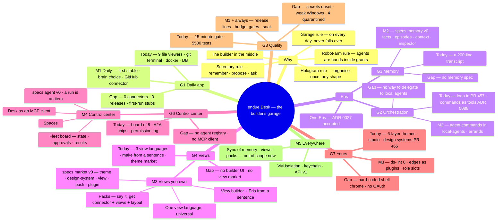

# endue Desk roadmap

2026-11-05 · Team endue

This is the English edition of `docs/ko/desk-roadmap.md`, the source of truth for *why* Desk exists and
*where* it goes. The structure is in `docs/architecture.md`, decisions that are hard to reverse in
`docs/adr/` (this direction is ADR 0093). When a milestone ends or the direction changes, both files change.

## Why: the builder's garage

Desk takes its inspiration from the garage workshop in the film *Iron Man*. Five things are in that garage.

| In the garage | What it means | In Desk |
| --- | --- | --- |
| A keyboard shaped like an arc: FILE MANAGEMENT and PROGRAMMING groups, NEW · OPEN · SAVE · REVERT, SIN · COS · TAN, all where one hand reaches | A tool is cut to one person's hands and work. Not a standard keyboard, *my* keyboard | No fixed screens. The person decides views, layout, keys and the design system (G4 · G7) |
| A hologram over the table: the suit, an engine, a car in the air, turned and taken apart by hand | What is being built is in front of you and can be touched. Data has a shape | Organise data once and draw it in any shape. Views are the product (G4 · G6) |
| The garage's AI assistant: unseen, aware of everything, asking first whether to keep what was just made, driving the robot arms | The assistant remembers, proposes, asks and coordinates. It does not decide for the owner | Eris: her own memory, orchestrating local and external agents, asking before anything hard to undo (G2 · G3) |
| The robot arms, welding and holding the extinguisher; the schematics on the wall screen | Agents have hands, but the person decides. Results are on the wall, at a glance | Agents are callers working inside their grants. A control center shows every agent and every result on one screen (G6) |
| The garage itself: the suit is built and tested there every day, and switching it on turns the whole room into one system | Real things get made here. The workshop switches on every day and does not fall over | One app that is one OS: a stable workshop a builder opens daily (G1 · G8) |

Iron Man is a trademark of Marvel. It is named here only as the source of the inspiration; this project has no
affiliation with or endorsement from Marvel, and no image from the film is in this repository.

In one sentence: **Desk is the garage a builder opens every day. Eris runs the garage, agents are the
hands, and everything shows in the view the builder wants.**

Desk's role is the helper's. It sets up a stable environment, leaves the builder free to shape it, and
keeps the quality of what they make at its best, without wavering. Desk does not decide how work is done.
The builder does.

### Five principles

1. **The builder in the middle.** The middle of the screen is the person's; Eris and agents stand at the
   edges. The first run's staging rule (`docs/ko/first-run-scenario.md`) is the product rule.
2. **The secretary rule.** Eris remembers, proposes and asks. Anything hard to undo happens only after
   approval (ADR 0078). Memory lives on the device; an account is only the way to carry it to another
   device later.
3. **The hologram rule.** Organise data once (items and the index, ADR 0032 · 0033) and draw it in any
   shape (universal views, ADR 0087). A view is data, not code, so people, Eris and the market all make
   the same thing.
4. **The robot-arm rule.** Agents are callers that run the same commands a person does, under their own
   name (ADR 0072). Hands, yes, but inside grants and on one screen.
5. **The garage rule.** It switches on every day. Releases, updates and test gates are part of the
   product, and stability and quality are never traded for a feature.

## The eight goals, and where they stand

| # | Goal | Today (2026-11-05, `main` 49a1d008) | Largest gap | Milestone |
| --- | --- | --- | --- | --- |
| G1 | An app builders use daily | Nine file viewers, git, terminal, docker, database and explorer are solid. Zero releases; sign-in, folder picking and connectors in the first run are stubs | No data carries a day (zero connectors). No installable build | M1 |
| G2 | Agent-native; Eris orchestrates | The agentic loop is arriving in the core (PR #457, ADR 0089). Commands become tools (ADR 0088). Eight local CLIs as a plugin (ADR 0084); other apps come in over MCP (ADR 0086) | Eris has no way to *delegate* to a local agent (local-agents flags 0 `agent` commands). Desk is an MCP server, not a client | M2 · M4 |
| G3 | Eris's own local memory | None. A 200-line transcript in `brain.json`, 50 messages in a frame, 30 searchable exchanges | No memory model, storage, recall or consent anywhere in specs, ADRs or requirements | M2 |
| G4 | Views people make and install | Three view languages (shell panes, ADR 0032 item views, ADR 0087 universal views). Make from a sentence (`desk.propose`, ADR 0073). A theme market (ADR 0060) | No builder UI. No view or plugin market (no `plugin.install`). Propose targets item views only | M3 |
| G5 | The garage's meaning | This document and ADR 0093 | — | — |
| G6 | A control center for agents | The local-agents board (8 cards at most), the shell's A2A chips, the permission log, approval cards (ADR 0078) | No agent registry or run model. Three sources (brain directory, local CLIs, MCP) and no single screen | M4 |
| G7 | My design system, UI and integrations | Six-layer themes, a studio and a market are solid. Design systems are arriving (PR #465). Every plugin has a token test | Shell chrome (rail, bars, bottom edge) is hard-coded in the runtime (ADR 0026 · 0028 proposed). No connector OAuth flow. Integration conventions (`*.task.move`) are not specs | M3 · M4 |
| G8 | A stable helper of the highest quality | A 15-minute gate, about 5,500 tests, red-on-base, scope-check, AI review. Release lines in PR #462 | Signing and updater secrets unset. Windows is unsigned NSIS, no MSI (#383). Four quarantined tests. The caller identity comes from the JS runtime | M1 + always |

## The survey

### Size

| Item | Count | Notes |
| --- | --- | --- |
| Age | 10 days | First commit 2026-10-27, 210 commits, 214 merged PRs |
| Rust crates | 14 | 67.9k lines including generated. `desk-core` is 29.7k (54 %) with 362 tests. `desk-vm` is an empty shell |
| TS packages | 5 | runtime 38.9k · ui 8.7k · plugin-sdk 5.6k · bridge 4.3k (+5.1k generated) · create-plugin 2.4k |
| Plugins | 46 | 20 workbench · 12 system and policy · 5 shell chrome · 4 view · 5 theme · 2 agent (eris, local-agents). About 139k lines of their own |
| Specs | 10 | bridge (about 80 methods, 24 permissions) · brain · plugin (8 kinds) · item (9 kinds) · view · universal · connector · init · update · wit. All v0 |
| ADRs | 77 pages | 0001–0088, 11 numbers unused, **12 proposed**. Themes: plugin 21 · core 10 · view 10 · data 10 · agent 8 |
| Tests | about 5,500 | vitest about 4,350 · cargo about 710 · Playwright about 270 · scripts about 170. Quarantined: 4 |
| Releases | 0 | No tags, an empty CHANGELOG. Every publish workflow stops because the secrets are unset |
| Open | 22 issues · 4 PRs | #457 Eris loop · #462 release lines · #463 Eris voice · #465 design systems |

### State by layer

- **Rust core.** A permission engine (deny by default, 24 scopes, per-agent allowlist, approvals, log),
  the command registry with undo, the item index (SQLite FTS5), the theme market, the updater pipeline
  (check, verify, stage; active only when the public key is injected) and init.yaml sync (to a
  `MockRemote`). The one brain is `HttpBrain`, defaulting to `brain-echo`. **The local brain (Ollama) is
  complete and wired to nothing.** Audio capture answers `unsupported`, the socket is Unix only, secrets
  sit in a 0600 file nothing reads.
- **Web runtime.** The compositor, windows, panes, profiles, desktops 1–4, the theme engine and studio,
  make-from-a-sentence, and Eris's body (mesh, soul text, sound rings). The shell chrome (rail, agent bar,
  bottom edge) is runtime code; the dock, sidebar and toolbar plugins are thin shells with "later" in
  their READMEs. Layout storage defaults to memory, with `desk.session` doing the real saving. The sample
  views (calendar, notes, tomorrow) are hard-coded.
- **Plugins.** The file plugins (docs, sheets, slides, reader, images, player, data, archives, web), the
  formats library, git, terminal, docker, database, explorer and calendar are solid. chat, mail, projects,
  today and chat-digest are well-built index clients **with no connector to feed them** (the built-ins
  are the OS calendar and reminders). git (9), terminal (7), calendar, database and docker offer agent
  tools; local-agents offers none.
- **Specs and decisions.** `specs/agent`, `specs/market`, `specs/sync` and `specs/memory` do not exist.
  Where the shell lives (0026), one Eris (0027), the edges (0028), agents as callers (0072), approvals
  (0078) and proposals (0073) are still proposed. The decision table in `desk-structure.md` stops at 0036
  and names React for screens, against ADR 0010. Two open PRs **both use ADR 0090** (#462, #465).
- **CI and releases.** Every PR runs check, unit, contract, red-on-base, runtime Playwright (2 retries),
  codegen-check, scope-check, security and AI review on Linux. macOS and Windows run on release branches
  only. App e2e is Linux only, performance budgets run nightly only, and the baseline is one darwin-arm64
  machine. Signing, notarisation, the updater key and the R2 token are not set.

### Where the open work lands

| Open | What | In this roadmap |
| --- | --- | --- |
| PR #457 (#456) | The desk runs Eris's agentic loop, errands drawn on screen, endue ID device sign-in, ADR 0089 | A premise of M1. M2 puts memory and delegation on top |
| PR #463 (#461) | Eris listens, thinks and speaks on a click; her body is opaque | M1 |
| PR #465 (#464) | Design systems as a main feature: component recipes, a studio, a market, ds-lint. ADR 0090 · 0091 | Merged in M1; M3 takes ds-lint to 0 and moves the shell chrome |
| PR #462 (#460) | Release lines, candidates on beta, a staged stable. ADR 0090 | M1's first release ships through it. The number clash is settled at merge |
| #321 · #322 · #351 | Apply on restart · panic hook · the app not passing files to the core | M1 |
| #272 · #273 · #383 | Frame watchdog and bridge rate limit · nightly soak and chaos · Windows MSI | The always-on quality track |
| #287 · #288 · #290 | plugins.lock · export and import · settings lint | M3 (premises of the market and packs) |
| #279 · #430 · #404 · #410 | Undo key · focus · mail · Eris timeline | M1 polish |

## The roadmap

A milestone ends with *what it becomes for the builder*. Dates are **estimated windows** from the last ten
days' pace (214 PRs, parallel lanes). M2, M3 and M4 run in parallel on separate lanes and finish in this
order.

| Milestone | Name | What becomes true | Window |
| --- | --- | --- | --- |
| M1 | Daily | The team opens Desk every day, the first stable build arrives through the updater, and Eris answers offline with a local brain | 2026-11 |
| M2 | Eris remembers | Eris has her own memory, carries on across restarts, hands work to local agents and brings the result back | 2026-12 |
| M3 | Views you own | Any source becomes the view you want from one sentence; views, packs and design systems come from the market; every edge of the shell is a plugin | 2027-01 |
| M4 | Control center | Every agent (local CLI, endue, MCP, Eris) is in one registry, and one screen shows state, approvals and results | 2027-02 |
| M5 | Everywhere | Sign in and memory, views and packs follow to another computer. MCP tools run inside a VM | 2027-Q2 |

### M1 Daily: a desk that opens every day

G1 · G8. A garage is a garage only if it switches on every day. Before features, a desk that *installs,
starts and answers*.

Work

1. Merge the four open PRs (#457 → #463 → #462 → #465) and settle the ADR numbers as 0089 · 0090 · 0091 ·
   0092.
2. Ship stable 0.1.0 through a release line. Set signing, notarisation, the updater key and R2 as
   `docs/releasing.md` says; make "Restart to update" really update (#321). The panic hook and `desk
   doctor` (#322); the app passing grants, settings and the log folder to the core (#351).
3. Choose a brain. Settings switch between endue AI, local (Ollama) and echo (removing `shell-bridge`'s
   "not served yet"), and the desk falls back to the local brain offline. Wire `desk-brain-local` into
   the app.
4. The first data that carries a day. A builder's day is git, issues, a calendar and notes. A first real
   connector reads GitHub issues and PRs as `task` items (a core `http` binding, secrets read only), and
   Today binds to tasks and notes.
5. Replace the three first-run stubs (endue ID, folder picking, connectors) with the real thing. The
   US-only notice becomes a setting.
6. A quality floor: a Windows socket (named pipe), the caller identity taken from the frame's origin
   instead of the runtime, a bridge rate limit and frame watchdog (#272), quarantined tests 4 → 0.

What becomes true, and how it is measured

- Every team member opens Desk on every working day (dogfooding days, time open).
- Stable 0.1.x installs on three OSes and updates arrive. Startup time and idle memory budgets gate PRs.
- With the network off, Eris still answers.

### M2 Eris remembers: a secretary who remembers and runs errands

G3 · G2. The garage's assistant remembers. Today Eris knows nothing once a session ends.

Work

1. **`specs/memory/v0`.** Memory has three layers: *facts and preferences* (YAML a person reads, "you
   review PRs in the morning"), *episodes* (transcripts of conversations, errands and results that
   outlive a session) and *working context* (what is open, recent commands, the items in view,
   automatic). All of it is a file set under the data folder, so M5's sync is a file sync (the ADR 0016
   model). Recall starts with `desk-index`'s FTS5; embeddings are added only when a local brain is there.
2. **`memory.*` on the bridge, with permissions.** `memory:read` and `memory:write` scopes. Eris writes
   by default, other agents by grant. A **memory inspector** for people: what she knows, forget, correct.
   A policy that asks "shall I remember this?" before a fact is stored (the ADR 0078 approval frame).
3. **Context assembled every turn.** The core gathers memory, working context and the open items before
   `brain.turn`. The local brain and endue AI receive the same shape (session metadata in `specs/brain`).
4. **One Eris.** ADR 0027 goes from proposed to accepted: `plugins/eris` and the shell's Eris merge.
   Errands (PR #457) move to the plugin side.
5. **Delegating to local agents.** The local-agents commands gain `agent`, so Eris hands work to Claude
   or Codex through `desk-run`, the result comes back as an errand, and the episode is remembered. The
   approval card (ADR 0078 → accepted) stops calls that are hard to undo.
6. The three agent-safety ADRs (0072 · 0073 · 0078) go from proposed to accepted.

What becomes true, and how it is measured

- After a restart Eris knows yesterday's work and my preferences. Deleting a line in the memory
  inspector really forgets it.
- "Run this repo's tests" goes to Claude Code and comes back in Eris's words. Anything hard to undo
  shows a card first.
- The same flow runs on the local brain alone.

### M3 Views you own

G4 · G7. Desk's core value. Once data is organised, the shape is the person's to make, or an LLM makes it
for them.

Work

1. **One view language.** Universal views (ADR 0087) become *the* view. Item views' `requires` (ADR
   0032) fold into the universal `items` source, and the missing components (chart, detail, stat) are
   added on the universal side. The shell's sample pane views become universal view files. One ADR
   records the transition rules.
2. **A view builder.** Pick a source (file, URL, command, items) → pick a shape (timeline, calendar,
   board, list, text, chat, agent, chart) → map fields → save. Eris does the same from one sentence
   (`desk.propose` retargeted at universal views; preview, apply and undo as in ADR 0073). A view is
   YAML, so both produce the same file.
3. **`specs/market/v0`.** The theme market's `desk-theme-index/1` widens by kind: theme ·
   design-system · view · pack · plugin. A `plugin.install` bridge method, sha256 and signatures (ADR
   0005), `plugins.lock` (#287), permission diffs shown before install. The index stays a static file in
   this repository, and a PR is the review.
4. **Packs.** Say "Jira" and a connector, views and a layout arrive as one data-only kind. The
   connector's core `http` binding and the OAuth flow become specs here. The integration conventions
   (`*.task.move`, `*.chat.send`, `*.mail.send`) move into `specs/connector`.
5. **Design systems to the end.** ds-lint 286 → 0; the shell chrome (rail, bars, bottom edge) moves into
   plugins (ADR 0026 · 0028 → accepted) so every edge can be swapped; `provides` role slots (BR-05)
   choose the palette and settings-UI providers. Export and import (#288) carry a desk as files.

What becomes true, and how it is measured

- Someone who is not a developer turns one URL into the view they want in under a minute, and changing
  the shape leaves the data alone.
- Views, packs and design systems install from the market, and a permission increase shows before
  install.
- Switching the design system carries 100 % of controls (ds-lint 0).

### M4 Control center

G6 · G2. The more agents, the more one screen is needed. The control center is not a new app; it is *a
view over agent runs*.

Work

1. **`specs/agent/v0`.** Whatever the source (local CLI, the endue AI directory, an MCP client, Eris),
   one record: id, name, colour, brain, tools, grants, state. A run goes into the index as `kind: run`,
   so every view can draw it (the same model as episodic memory).
2. **`agent.runs.*`** on the bridge: start, cancel, waiting for approval, result. A background queue
   (AG-07) that holds work offline.
3. **The control center view.** A fleet board on the universal `agent` shape: who is running, who waits
   for approval, what finished, what the result is. Cost and time. One approval inbox. This screen is a
   view file too, so it can be changed.
4. **Desk as an MCP client.** External MCP servers attach as tools: in-process under grants first, VM
   isolation (ADR 0002) in M5.
5. **Spaces (AG-06).** Two or more agents, a shared surface and a shared store. The first run's "a space
   to work together" scene becomes real.

What becomes true, and how it is measured

- Claude Code, an endue agent and an app over MCP sit on one board, each stoppable and approvable.
- Eris splits one job across three of them and gathers the results in one view.

### M5 Everywhere: the same desk anywhere

G3's sync and G8's depth. Out of scope now, but M2's file layout assumes this step.

- `specs/sync/v0` and `specs/account/v0`: memory, views, packs and settings follow the endue ID. File-level
  3-way, conflicts never overwritten (ADR 0016). Grants, secrets and logs stay on the device (SY-03).
- MCP tool isolation in `desk-vm`, the OS keychain, Windows signing and an MSI, the 3D compositor, the
  plugin API v1 freeze (ADR 0004).

### Always-on tracks

- **Quality.** The release lines' canary → beta → stable run weekly. Performance budgets gate PRs on three
  OSes. Nightly soak, chaos and bridge fuzzing (#273). Quarantined tests stay at 0.
- **Docs.** `desk-structure.md`'s decision table reaches the latest ADR; `desk-requirements.md`'s
  *today* column moves at every milestone. ADR numbers are reserved in this document's open-work table
  when a PR opens.
- **Dogfooding.** The team builds Desk with Desk. Every week, one line of "what Desk got in the way of
  today" becomes an issue.

### What we do not do

The list in `docs/ko/desk-requirements.md` stands: not an IDE, no scripting language of its own, no
embedded browser engine, no telemetry, nothing but the brain that needs the cloud. Two more: memory does
not sync before M5, and there is no mode in which an agent does something hard to undo without a person's
approval.

## Killer-feature lanes

Twelve features ranked by the moment a person feels them. Four lanes run at once and each lane runs in order
(ADR 0015). The open PRs #457 and #462 are each lane's first job.

| Rank | The moment a person feels | Issues | Lane |
| --- | --- | --- | --- |
| 1 | One sentence turns any source into the view they want | #472 · #474 | views |
| 2 | Tell Eris, a local agent works, the result comes back | #469 | agents |
| 3 | My GitHub issues and PRs live in Today and Projects | #473 | daily |
| 4 | After a restart Eris still knows yesterday | #467 · #468 | eris-core |
| 5 | Every agent on one board, with an approval inbox | #470 | agents |
| 6 | Name a service, get its connector, views and layout (packs) | #476 | daily |
| 7 | Install views, packs and design systems from the market | #475 | daily |
| 8 | With the network off, Eris still answers | #466 | eris-core |
| 9 | The design system reaches every control and the shell's edges | #478 · #477 | agents · views |
| 10 | External MCP servers attach as tools | #471 | agents |
| 11 | It installs, starts and updates itself | #351 · #322 · #321 | eris-core |
| 12 | Carry my desk as files | #287 · #288 | daily · views |

| Lane | Order | ADR numbers |
| --- | --- | --- |
| eris-core | #457 → #466 → #351 → #467 → #468 → #322 → #321 | 0094–0097 |
| agents | #471 → #469 → #470 → #478 | 0098–0101 |
| views | #472 → #288 → #474 → #477 | 0102–0105 |
| daily | #462 (to ADR 0092) → #473 → #287 → #475 → #476 | 0106–0109 |

## Mindmap

## Open questions

- [ ] When the facts layer of memory is YAML a person edits, how are Eris's lines told from the person's?
- [ ] When views merge into universal views, where do item views' `requires` (binding connector instances) go?
- [ ] When the market takes `plugin` (code) as a kind. Data-only kinds (view, pack, theme, design-system) first?
- [ ] Retention and size caps when control-center runs are index items
- [ ] Whether the first stable targets macOS only (before Windows signing)
